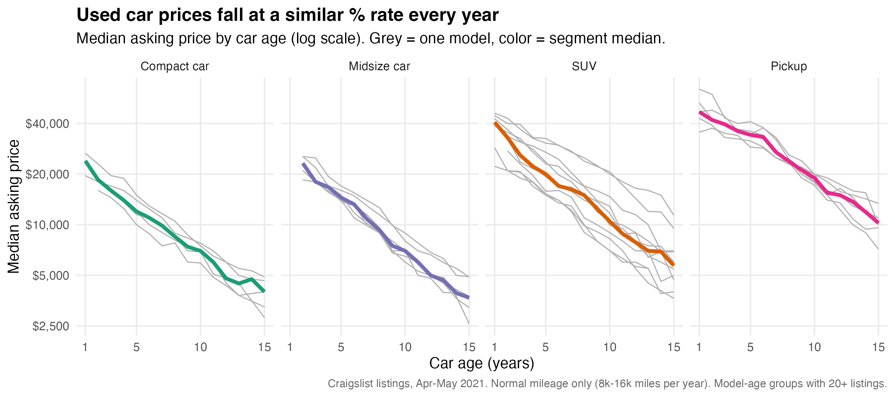
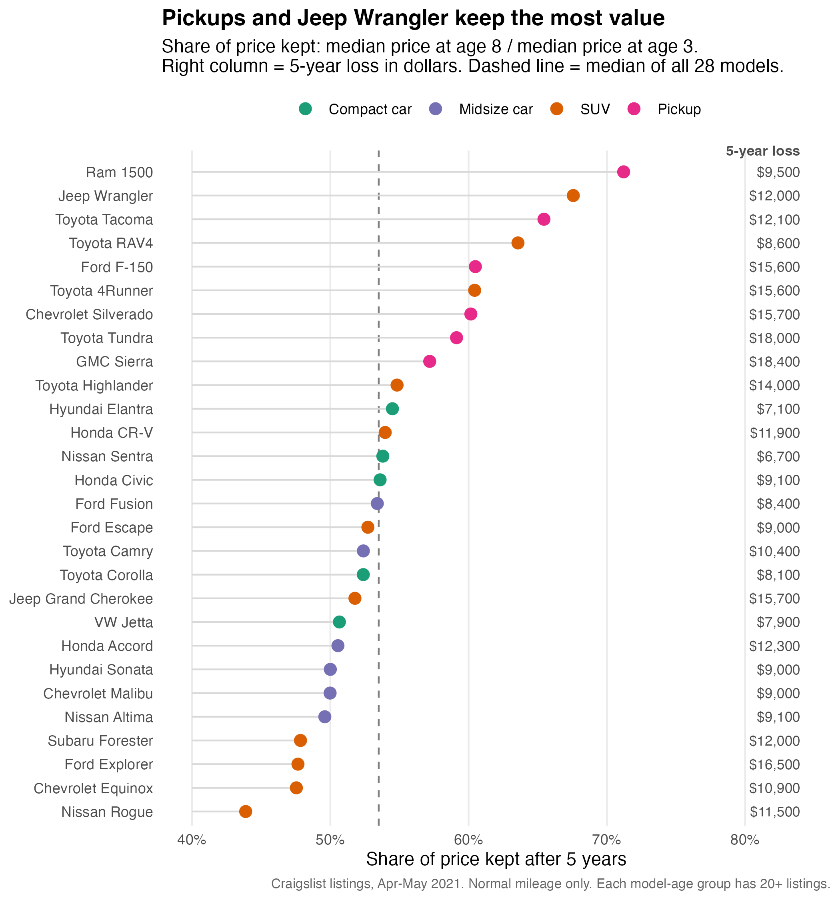

# Initial Analysis

We use 35,394 Craigslist listings (April–May 2021) of 28 popular models in four segments. We keep only cars with normal mileage (8,000–16,000 miles per year of age) and model–age groups with at least 20 listings. Code: `R/03_figures.R`.

## Price by Car Age

The y-axis is on a log scale, so a straight line means the car loses the same percent of its price every year. For compact cars, midsize cars and SUVs the lines are almost straight. They lose about 11–12% per year at age 2–4 and also at age 5–8.

In dollars it looks different. A compact car loses about \$2,000 per year at age 2–4 but only about \$550 per year at age 9–15, because the same percent is taken from a smaller price.

Pickups do not follow this pattern. They lose only about 7% a year when they are young (age 2–4), and the drop becomes faster (around 11–12%) after age 9.

So H1 is true in dollars, but not really in percent. We don't see an age where the price stops falling, older cars just lose fewer dollars because they are cheaper. For the main analysis we plan to report both measures, and fit log(price) on age for each model to check if the yearly drop really changes with age.

## Share of Price Kept by Model

{ width=62% }

Here we imagine someone buys a car at 3 years old and sells it at 8. Some things we noticed:

- The gap between models is big. Ram 1500 keeps 71% of its price and Jeep Wrangler 68%, but Nissan Rogue keeps only 44%.
- All six pickups are above the median (54%). The median pickup keeps 60%, the other segments are around 50–54%.
- Toyota trucks and SUVs do well (Tacoma 65%, RAV4 64%), but Camry, Corolla, Civic and Accord are only around the median or below it. So a reliable brand alone does not explain it.
- Pickups keep the biggest share but they also lose the most dollars (\$15,600–\$18,400) since they are expensive. The Nissan Sentra loses the least, only \$6,700.

This supports the pickup part of H2, but not the part about reliable sedans. It also means the answer to who loses the least money depends on whether we look at percent or dollars. Next we will repeat this for every buying age (1–10) and control for mileage, condition and seller type.
